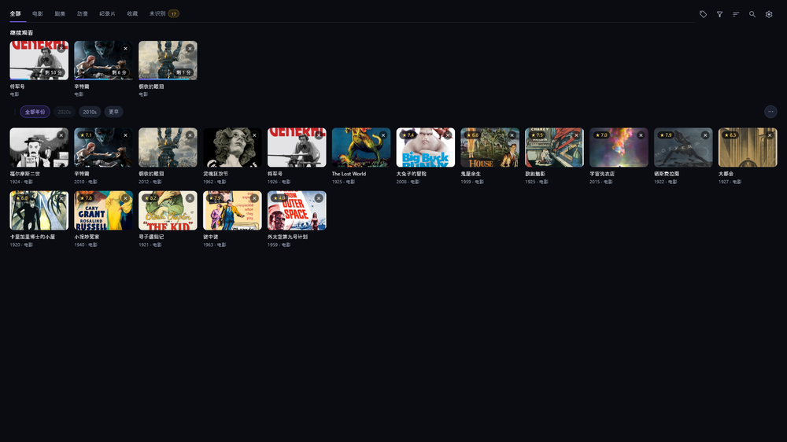
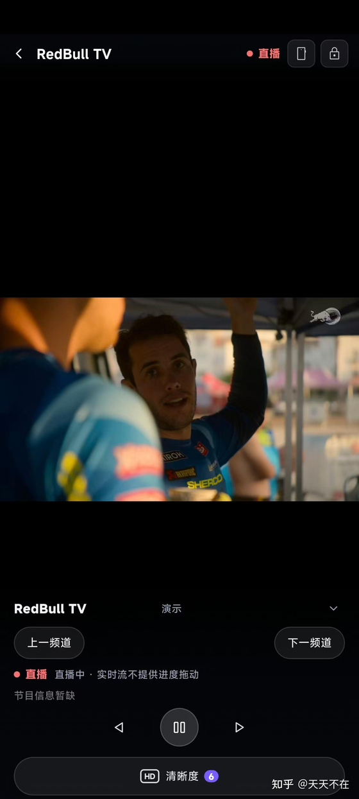
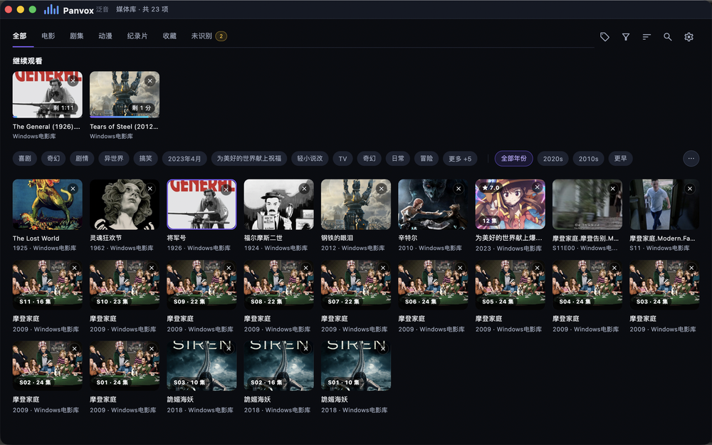
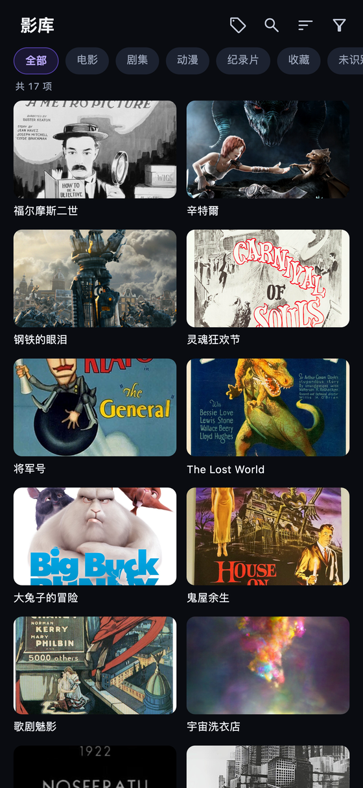
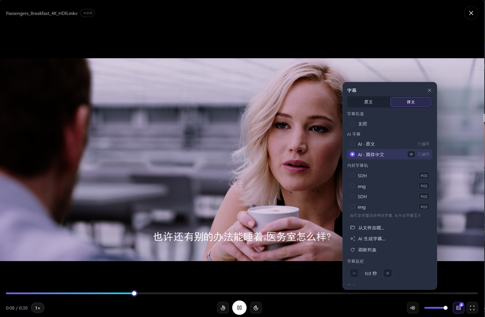
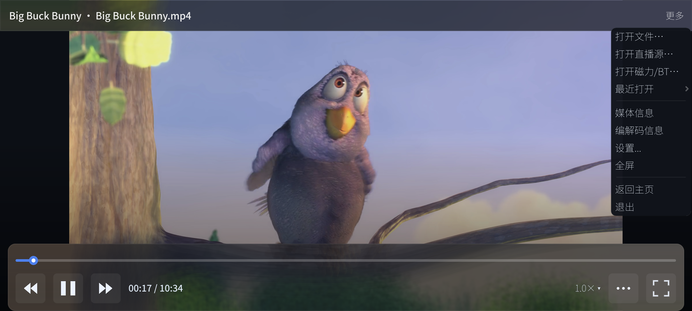

# avox

**English | [简体中文](README.zh-CN.md)**

avox is a cross-platform audio/video library in C++17. Capture, hardware decoding, Vulkan image processing, rendering, hardware encoding and streaming run through one pipeline.

The player is its most complete module. WebRTC calls, AI (speech recognition, translation, image restoration, super-resolution) and the XR / virtual-production modules attach to the same set of interfaces as plugins, so a product ships only the parts it uses.

> C++17 · Windows / Android / iOS / macOS / Linux · AGPLv3, commercial license available · v1.0.0969

[]()
[]()
[](LICENSE)
[]()
[]()
[](https://github.com/xxxzhou/avox)

avox comes from the author's years of audio/video and GPU work, organized into a library with LLM assistance. The lineage runs from [OEIP](https://zhuanlan.zhihu.com/p/104027165) (UE4/Unity3D multimedia pipeline) to [aoce](https://github.com/xxxzhou/aoce) (cross-platform Vulkan GPU image processing); the key implementation work is written up as articles, listed under [Technical deep dives](#technical-deep-dives).

**Contents** · [Products](#products-built-with-avox) · [At a glance](#at-a-glance) · [Core features](#core-features) · [Technical deep dives](#technical-deep-dives) · [Evolution](#evolution) · [Quick start](#quick-start) · [FAQ](#faq)

## Products built with avox

**Panvox** is a cross-platform video player built on avox: the product layer is Flutter, the engine layer is this library, and playback, hardware decoding, the GPU pipeline, subtitle rendering and AI capabilities are reused through the C ABI. It covers Windows, macOS, iOS and Android.

- **Windows** - [Microsoft Store](https://apps.microsoft.com/detail/9PG77H33P7K8)
- **iOS / iPadOS / macOS** - [App Store](https://apps.apple.com/cn/app/panvox-player/id6819539073), one page for all three; macOS requires 12.0+ and Apple silicon
- **Android** - [internal test build](https://play.google.com/apps/test/RQo-NZmDUok/ahAO29uNRS3gG4ZDC35BtgMLCLvoQyam1Kvd6wGKPphYU5aCzPQ-UiYxxlxAB4ZtodrH0fTBAETk3--ARIvcjm3KQT) (tap "Play Store version" 7 times → Developer options → Internal app sharing)

What has shipped in the product: a poster-wall media library (direct play from NAS / SMB / WebDAV / Jellyfin), no transcoding, full ASS/PGS/SRT rendering, per-frame HDR tone mapping, AI subtitles and auto-tagging, IPTV (m3u + EPG).

<table align="center">
  <tr>
    <td valign="middle"></td>
    <td valign="middle"></td>
  </tr>
  <tr>
    <td valign="middle"></td>
    <td valign="middle"></td>
  </tr>
</table>

Product overview and implementation notes: [panvox.net](https://panvox.net/en/panvox/); article version: [From the open-source engine avox to a product: Panvox, a cross-platform player](https://panvox.net/en/panvox/articles/engine-to-product/).

## At a glance

- **One codebase, five platforms** - Windows, Android, iOS, macOS and Linux share one C++17 codebase and one CMake build. Hardware decode/encode, GPU interop and window-system differences stay in the platform layer, so adding a platform means implementing that layer only.
- **Decoded frames stay on the GPU** - native textures from DX11VA, MediaCodec and VideoToolbox enter the Vulkan pipeline directly, then go back to render or hardware encode without passing through CPU memory.
- **Interfaces defined once, four languages available** - the export layer is pure-virtual interfaces + `create*` factories + `addXxxOb/removeXxxOb` callbacks, with no STL types across the ABI. SWIG generates the C# / Java / Node.js / Python bindings from the same headers, and callback classes are inherited and overridden in each language through directors, so a new interface needs no per-language glue.
- **WebRTC without forking** - a wrapper module adds the decoders, AAC, 3A audio and the data-source/encoder mapping, so upgrades follow upstream with no source debt.
- **AI and XR load on demand** - speech recognition, translation, image restoration, object detection and the virtual-production modules exist as dynamic plugins or separate modules; the playback path runs without them.

## Core features

### Playback

- **Live streams** - RTSP/RTMP/HTTP-FLV/HLS and other protocols, magnet links, WebRTC; both ZLMediaKit and FFmpeg parsing paths.
- **Local media** - common audio/video formats.
- **Device capture** - cameras, microphones and screen capture share one data-source model (Windows Media Foundation / Android NdkCamera2 OES textures delivered directly / iOS camera).
- **Playback control** - A/V sync (audio, video and external clocks, following ffplay's logic), speed control, low-latency adaptive buffering for live streams, dynamic software/hardware decoder switching, dynamic window switching, multiple streams in one player.
- **Cross-platform rendering** - ISurfaceRender unifies Vulkan / DX11 / DX12 / Metal / OpenGL ES window rendering, with each platform's hardware-decode frames going zero-copy into the matching backend (external memory sharing / texture passthrough).
- **Pluggable sources and decoders** - pulling, decoding and encoding are layered and decoupled; each layer is a standalone source and replaceable on its own (IAVSource / IRawSource), not tied to FFmpeg. FFmpeg (general formats), ZLMediaKit (RTSP/RTMP live) and WebRTC (real-time calls) are built in and switched per source (IoPlan); a private protocol that implements IAVSource registers as a new IO option; all three share the same H264/H265/AAC software and hardware decoders and render pipeline.

### Hardware decoding and the zero-copy path

| Platform | Hardware decode | Decoded frame → Vulkan zero-copy path | Render backend |
|----------|-----------------|----------------------------------------|----------------|
| Windows | DX11 (D3D11VA) | DX11 texture ↔ Vulkan interop | DX11/DX12/Vulkan |
| Android | MediaCodec | AHardwareBuffer ↔ Vulkan | OpenGL ES/Vulkan |
| iOS | VideoToolbox | IOSurface ↔ Vulkan | Metal/Vulkan |
| Linux | VAAPI (planned) | - | Vulkan |

- Native GPU textures from hardware decoding enter the Vulkan processing pipeline or map to the render window, never through CPU memory.
- Vulkan ↔ OpenGL ES (Android) and Vulkan ↔ DX11 (Windows) texture interop.
- Android decode and render across EGLContexts, and the iOS path through Metal/IOSurface, both have working implementations.

### Hardware encoding, streaming and recording

- **Android** - MediaCodec GPU encoding: camera OES textures go through Vulkan processing straight into the encoder, never touching CPU memory.
- **iOS** - VideoToolbox hardware encoding: camera frames or Vulkan processing results encode directly.
- **FFmpeg software encoding** - the cross-platform fallback; the muxer writes local files and streams over RTMP/RTSP.
- **Multi-platform two-way video calls** - pull → decode → render → encode → push, end to end (Windows/Android/iOS/Linux), each stage switchable between software and hardware, with synchronized local recording.

### Vulkan GPU image processing

- 100+ filters and effects: the entire GPUImage family ported to Vulkan Compute Shaders.
- Layer + PipeGraph composable compute graphs, with cross-platform GPU data mapping (OpenGL ES / Metal / DX11 ↔ Vulkan).
- FreeType + Compute Shader text rendering for timestamps and subtitle overlays.
- Anime4K super-resolution integrated (GLSL converted to Vulkan Compute Shaders, fitting the built-in pipeline composition).
- Performance reference: 1080p per processing layer 0.1–0.3 ms (RTX 2070; see [filter timing measurements](https://zhuanlan.zhihu.com/p/1931653908276704034)).

### WebRTC integration

WebRTC sources are not modified; a wrapper module extends:

- the player's H264/H265 software and hardware decoders into the WebRTC decode factory (including native H265 support in WebRTC M138)
- an AAC audio decoder (WebRTC itself only supports opus/g711)
- player data sources (IVideoSource / IAudioSource) and the cross-platform hardware encoders into the WebRTC push path
- WebRTC 3A audio processing (AEC echo cancellation / ANS noise suppression / AGC gain) into capture and streaming
- WebRTC frames render directly to the player's native windows on each platform

### AI capabilities

AI modules load as dynamic plugins (`plugins/`) and are probed at runtime:

- **Real-time speech subtitles** - SourcePlayer recognizes microphone or screen audio streams with about 200 ms latency; MediaPlayer recognizes video audio first and then translates it into subtitles (Sherpa-ONNX + neural machine translation).
- **AI image restoration** - YOLO26-Seg watermark/object instance segmentation plus inpainting, fully automatic (evolved from an earlier frame-difference + edge-analysis approach).
- **AI inference** - general ONNX Runtime / NCNN inference (YOLO detection, facial landmarks, etc.) with direct Vulkan memory input/output.
- **Multimodal agent** - LLM integration for image-text dialogue and tool-chain calls.

<p align="center">
  
  <br><em>AI subtitles in Panvox: on-device recognition, translation, then embedded playback</em>
</p>

### XR, virtual production and engine passthrough

VR/MR camera tracking, virtual-production calibration and MR compositing are validated in production and integrated into avox:

- **VR/MR camera tracking** - LED virtual-production camera tracking benchmarked against Redspy/MoSys: monocular + IMU, infrared reflective markers ([tracking algorithm](https://zhuanlan.zhihu.com/p/705932365)).
- **Camera calibration** - g2o graph-optimization intrinsic calibration, hand-eye calibration, single-image intrinsic fitting for zoom lenses ([implementation notes](https://zhuanlan.zhihu.com/p/705988110)).
- **MR compositing** - virtual and real cameras mixed for XR shoots: calibration + distortion correction, with about 3 pixels reprojection error ([implementation notes](https://zhuanlan.zhihu.com/p/705965901)).
- **LED wall point cloud** - SLAM-style point-cloud and mesh generation with ORB_SLAM3 ([implementation notes](https://zhuanlan.zhihu.com/p/705975323)).
- **Ultra-low-latency transport** - Rivermax (GPU Direct RDMA) and NDI for LAN video transport ([implementation notes](https://zhuanlan.zhihu.com/p/706037895), built to avoid NDI's 100 ms+ latency).
- **Game-engine passthrough** - zero-copy texture-level integration both ways for UE5, Unity3D and Godot: camera or GPU pipeline → engine texture, engine RenderTarget → pipeline → stream (`platform/ue`, `platform/unity`, `platform/godot`). Playback, calls and AI run natively inside the engine instead of an embedded player window.
- **Digital human** - driving and render-pipeline integration (module being integrated).

<p align="center">
  
  <br><em>Android + Godot: texture-level passthrough playing a magnet link</em>
</p>

### Multi-language SDK

- **C++** native interface; **SWIG** generates C# / Java / Node.js / Python bindings (including cross-thread callbacks).
- UI demos on each platform: Win32, Android (Java), iOS (ObjC), [Electron (JS)](https://zhuanlan.zhihu.com/p/1943737922852460208), [Avalonia (C#)](https://zhuanlan.zhihu.com/p/1991912977230733329).

## Technical deep dives

The key implementation work is written up as articles. **The current, rewritten edition is serialized at [panvox.net — Building a Cross-Platform Player](https://panvox.net/en/tech/build/) in English** (Chinese edition: [panvox.net/tech/build/](https://panvox.net/tech/build/)); earlier thematic articles are in Chinese, under [the author's article feed](https://www.zhihu.com/people/zhou-xin-12-70-21/posts):

**Panvox product and implementation (2026)**

- [From the open-source engine avox to a product: the cross-platform player Panvox](https://panvox.net/en/panvox/articles/engine-to-product/) - the whole product: playback, library, subtitles, AI, IPTV
- [HDR playback across platforms: passthrough, shaping and per-frame tone mapping](https://panvox.net/en/panvox/articles/hdr/)
- [Flutter ↔ avox video-frame interop: from Texture to native window](https://panvox.net/en/panvox/articles/flutter-frames/)
- [ASS/PGS/SRT across platforms: three render paths and four canvases](https://panvox.net/en/panvox/articles/subtitles/)
- [Building avox core and plugins across platforms: dynamic or static, the platform decides](https://panvox.net/en/panvox/articles/build-plugins/)
- [4× playback speed: decoder ceilings and I-frame mode](https://panvox.net/en/panvox/articles/speed-4x/)
- [Remote access: direct, relayed, authorized once](https://panvox.net/en/panvox/articles/remote-access/) - your home library away from home

**Player framework and multi-platform porting**

- [Player framework](https://zhuanlan.zhihu.com/p/1924535781558555955) - overall design of the multi-platform player framework
- [Player FFmpeg](https://zhuanlan.zhihu.com/p/1924537408311001536) / [Player Android](https://zhuanlan.zhihu.com/p/1924537652897625121) / [Player iOS](https://zhuanlan.zhihu.com/p/1924537772141679194) / [Multi-platform Vulkan integration](https://zhuanlan.zhihu.com/p/1925515227908268800) / [Multi-platform demo](https://zhuanlan.zhihu.com/p/1925515494309492633)
- [Streaming protocol parsing in the ZLMediaKit playback path](https://zhuanlan.zhihu.com/p/1925912219486521028) - live protocol parsing
- [Time-related playback features](https://zhuanlan.zhihu.com/p/1948834769115780459) - A/V sync, speed control, low-latency adaptation

**Zero-copy hardware decode → GPU path**

- [Vulkan × DX11 interop](https://zhuanlan.zhihu.com/p/349534525) - Windows decode textures straight into Vulkan
- [Android hardware decode into the Vulkan pipeline via AHardwareBuffer](https://zhuanlan.zhihu.com/p/1933240978434679422)
- [iOS hardware decode into the Vulkan pipeline via IOSurface](https://zhuanlan.zhihu.com/p/1933834616818636429)
- [Vulkan × OpenGL ES texture interop on Android](https://zhuanlan.zhihu.com/p/302285687)
- [Rendering NdkCamera2 OES textures](https://zhuanlan.zhihu.com/p/1967658409848440079) - zero-copy camera capture

**Hardware encoding and real-time calls**

- [Android MediaCodec GPU encoding](https://zhuanlan.zhihu.com/p/1977347530166666089) / [iOS hardware encoding](https://zhuanlan.zhihu.com/p/1987119873403417887)
- [Multi-platform two-way video calls](https://zhuanlan.zhihu.com/p/1987128340973368623) - switching between software and hardware at each stage
- [Integrating WebRTC 3A audio processing into the player](https://zhuanlan.zhihu.com/p/1963601511633389459)

**WebRTC integration**

- [Player WebRTC](https://zhuanlan.zhihu.com/p/1929598509927076242) - integration overview
- [Integrating local player decoders into WebRTC](https://zhuanlan.zhihu.com/p/1938686818565494734) - H264/H265 software and hardware decode
- [Integrating an AAC decoder into WebRTC](https://zhuanlan.zhihu.com/p/1941208736648636312)
- [Mapping audio/video sources and encoders into WebRTC](https://zhuanlan.zhihu.com/p/2000598286206248428)

**Vulkan image processing**

- GPUImage porting series: (1) [Gaussian blur and adaptive threshold](https://zhuanlan.zhihu.com/p/356355306), (2) [Harris corners and guided filter](https://zhuanlan.zhihu.com/p/359787506), (3) [Filters A–C](https://zhuanlan.zhihu.com/p/364888786), (4) [Filters D–O](https://zhuanlan.zhihu.com/p/369930003), (5) [Filters P–Z](https://zhuanlan.zhihu.com/p/372843997), [summary](https://zhuanlan.zhihu.com/p/373137758), [Android demo](https://zhuanlan.zhihu.com/p/388055520)
- [Vulkan filter timing](https://zhuanlan.zhihu.com/p/1931653908276704034) - measured per pipeline layer
- [Vulkan text rendering in the player](https://zhuanlan.zhihu.com/p/1963601925418234137) - FreeType subtitles/timestamps
- [Integrating Anime4K super-resolution into the player](https://zhuanlan.zhihu.com/p/2043258134546974507)

**AI and algorithms**

- [Real-time speech recognition and translation in the player](https://zhuanlan.zhihu.com/p/2035763455190373290)
- [AI image restoration](https://zhuanlan.zhihu.com/p/2037495059705221313) - YOLO-Seg watermark removal
- [Optimizing real-time facial landmark detection with NCNN](https://zhuanlan.zhihu.com/p/407299327) / [Vulkan input/output in NCNN](https://zhuanlan.zhihu.com/p/411106967) - on-device inference with direct GPU memory access
- [A CUDA implementation of GrabCut](https://zhuanlan.zhihu.com/p/59283449) - early GPU segmentation work

**Engineering practice**

- [Converting C++ to other languages with SWIG](https://zhuanlan.zhihu.com/p/379049985) / [Cross-thread callbacks in SWIG Node.js native extensions](https://zhuanlan.zhihu.com/p/1969758141236372869)

## Evolution

| Period | Project | Main output |
|--------|---------|-------------|
| 2019-2020 | oeip (Windows) | CUDA/DX11 image pipeline, FFmpeg pull/push streaming, UE4/Unity3D texture passthrough, CUDA GrabCut/guided filter, YOLO integrated into game engines |
| 2020-2021 | [aoce](https://github.com/xxxzhou/aoce) (cross-platform) | Vulkan Compute image pipeline, 100+ GPUImage filter ports, Android/iOS camera capture, chroma-keying, NCNN on-device inference, SWIG multi-language |
| 2024-now | avox | Player SDK: multi-platform hardware decode/encode, zero-copy GPU path, the full WebRTC stack, AI subtitles/restoration/super-resolution, multi-language SDK; XR and virtual-production modules integrated |
| 2026 | **Panvox** | Cross-platform player on avox: Flutter product layer + avox C ABI; live on Windows and both Apple platforms; playback, library, subtitles, AI and IPTV all shipped |

The XR / virtual-production work started during aoce, where it was fully validated on real shoots, and now lives in avox.

## Quick start

### Build requirements

- CMake 3.16+
- Visual Studio 2019+ (Windows)
- NDK 26.1.10909125 (Android)
- Xcode 14+ (iOS)
- GCC/Clang and the Vulkan SDK (Linux)

### External dependencies

Large dependency libraries (WebRTC, ONNX Runtime, OpenCV, etc.) live in an `../avox_library` directory next to this project and are found automatically. Override with an environment variable or a CMake option:

```bash
export AVOX_EXTERNAL_LIBRARY_DIR=/path/to/avox_library
# or
cmake -DAVOX_EXTERNAL_LIBRARY_DIR=/path/to/avox_library ...
```

### Build commands

```bash
python build_windows.py   # Windows x64
python build_android.py   # Android arm64-v8a/armeabi-v7a
python build_ios.py       # iOS arm64/x86_64
python build_mac.py       # macOS arm64/x64/universal (needs macOS + Xcode)
python build_linux.py     # Linux x64

# Unit tests (built with the project; run manually)
ctest --test-dir build/windows/avox --output-on-failure -C Release
```

The build scripts take a custom build type (Debug/Release) and target architecture. **Release is the default and artifacts carry no debug symbols**; enable Debug explicitly with `AVOX_BUILD_TYPE=Debug`. Details are in [doc/build/构建.md](doc/build/构建.md) and in each script's options.

## Repository layout

```
avox/
├── src/                       # core SDK sources
│   ├── avox/                   # core player framework (avox module)
│   │   ├── player/            # MediaPlayer / SourcePlayer
│   │   ├── source/            # data sources (IAVSource / IRawSource)
│   │   ├── video/ audio/      # video/audio decoder base classes
│   │   ├── codec/             # codec abstractions
│   │   ├── muxer/             # media muxing
│   │   ├── subtitle/          # subtitles
│   │   ├── layer/             # layer composition
│   │   ├── module/            # dynamic module management (IModule / ModuleMgr)
│   │   └── neural/            # neural network / AI interfaces
│   ├── avox_aac/               # AAC codec (faac/fdk-aac)
│   ├── avox_ffmpeg/            # FFmpeg demuxing/software & hardware decode
│   ├── avox_zlmediakit/        # ZLMediaKit live streaming (RTSP/RTMP)
│   ├── avox_vulkan/            # Vulkan GPU processing pipeline
│   ├── avox_freetype/          # FreeType text rendering
│   ├── avox_egl/               # EGL contexts
│   ├── avox_agent/             # multimodal AI agent
│   ├── avox_cmd/               # command-line interface (CLI)
│   ├── avox_windows/           # Windows platform implementation
│   ├── avox_android/           # Android platform implementation
│   ├── avox_apple/             # Apple platform implementation (iOS/macOS)
│   └── avox_linux/             # Linux platform implementation
├── plugins/                   # dynamic plugin modules (loaded at runtime)
│   ├── avox_webrtc/            # WebRTC integration
│   ├── avox_onnx/              # ONNX inference
│   ├── avox_opencv/            # OpenCV image processing
│   ├── avox_sherpa/            # Sherpa-ONNX speech recognition
│   ├── avox_translation/       # neural machine translation
│   └── avox_cv/                # AI image restoration (watermark removal) + general YOLO
├── swig/                      # SWIG language bindings
│   ├── csharp/                # C# SDK
│   ├── nodejs/                # Node.js SDK
│   └── python/                # Python SDK
├── platform/                  # per-platform SDK wrappers and UI demos
│   ├── windows/ android/ ios/
│   └── avalonia/              # cross-platform C# demo (Avalonia)
├── samples/                   # feature test samples
├── glsl/                      # Vulkan GLSL shaders (.glsl → .spv)
├── cmake/                     # CMake build scripts and toolchains
├── script/                    # helper scripts (dependency download, packaging)
├── 3rdparty/                  # third-party dependency sources
├── assets/                    # resources (fonts, images, models)
├── doc/                       # project documentation
└── build/                     # build output
```

## Architecture

```
┌─────────────────────────────────────────────────────────────┐
│                      Application Layer                       │
│           (C# / Java / JS / Python / Swift / ObjC)          │
├─────────────────────────────────────────────────────────────┤
│                      SDK Layer (SWIG)                        │
├─────────────────────────────────────────────────────────────┤
│                       Core Player                            │
│  ┌──────────┐  ┌──────────┐  ┌──────────┐  ┌──────────┐   │
│  │ IO Thread │→ │ Decoder  │→ │ Render   │→ │ Output   │   │
│  │           │  │ Thread   │  │ Thread   │  │          │   │
│  └──────────┘  └──────────┘  └──────────┘  └──────────┘   │
├─────────────────────────────────────────────────────────────┤
│  Data Sources          Decoders           Renders           │
│  ┌─────────────┐      ┌─────────┐        ┌──────────┐      │
│  │ FFmpeg      │      │ HW:     │        │ DX11/12  │      │
│  │ ZLMediaKit  │      │ MediaCodec│       │ Metal    │      │
│  │ WebRTC      │      │ VideoToolbox│     │ Vulkan   │      │
│  │ Device      │      │ SW: FFmpeg│       │ OpenGL ES│      │
│  └─────────────┘      └─────────┘        └──────────┘      │
├─────────────────────────────────────────────────────────────┤
│  Vulkan GPU Pipeline        │        Dynamic Plugins        │
│  (100+ Effects)             │   (WebRTC / ONNX / ASR / ...) │
└─────────────────────────────────────────────────────────────┘
```

## API conventions

- **`create`-prefixed APIs** return objects the caller owns and must release.
- **`get`-prefixed APIs** return managed objects that must not be released.
- **Callbacks** register with `addXxxOb()` / `removeXxxOb()`; unregister before releasing the callback object.

```cpp
IMediaPlayer* player = createMediaPlayer();          // owned by caller, must delete
ISurfaceRender* render = player->getSurfaceRender(); // managed, do not release
```

## FAQ

**What is avox?** A cross-platform audio/video capability library in C++17: capture → hardware decode → Vulkan GPU processing → render → hardware encode/streaming, with the player as its most complete module.

**Which platforms are supported?** Windows, Android, iOS, macOS and Linux (VAAPI hardware decoding on Linux is planned).

**What handles input and decoding?** Pulling and decoding are layered and decoupled, with built-in FFmpeg (general formats), ZLMediaKit (RTSP/RTMP live) and WebRTC paths; hardware decoding goes through D3D11VA / MediaCodec / VideoToolbox into one zero-copy Vulkan pipeline.

**What language bindings are there?** C++ natively; SWIG generates C# / Java / Node.js / Python; UI demos cover Win32, Android (Java), iOS (ObjC), Electron (JS) and Avalonia (C#).

**Can it be used commercially?** The license is AGPLv3; a commercial license is available.

**Where is the documentation?** Start at [doc/INDEX.md](doc/INDEX.md); the technical series is at [panvox.net/tech/build/](https://panvox.net/tech/build/) (Chinese).

## Documentation

- **[doc/INDEX.md](doc/INDEX.md)** - documentation index (modules, APIs, platform integration, build configuration)
- **[doc/reports/README.md](doc/reports/README.md)** - troubleshooting casebook: settled cases with root cause, fix commit and reusable criteria
- **[DeveloperGuide.md](DeveloperGuide.md)** - C++ coding standards and cross-DLL safety rules
- **[CLAUDE.md](CLAUDE.md)** - project structure overview and AI-assisted development guide
